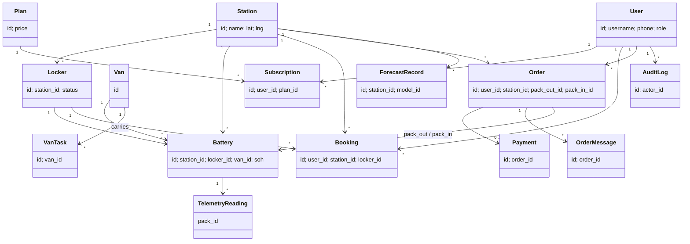
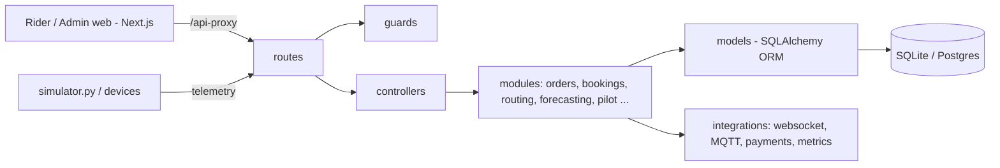
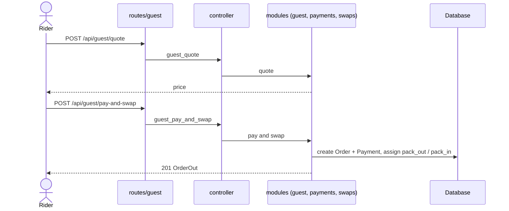

# Voltora: report notes, limitations and UML

## 1. Limitations and what was not checked

- **CI is untested.** The GitHub CI files (backend, then the frontend CI file) have not been run on GitHub.
- **The k-d tree is not used by the live nearest-station route.** Building a tree on every request gives no speed-up
  (build is O(n log n), a linear scan is O(n)). It would only help with a tree kept in memory at startup.
  `utils/structures.py::KDTree` exists, is tested (`tests/test_structures.py`) and is benchmarked
  (`scripts/benchmarks.py` -> `results/runtime_vs_size.csv/png`).
- **`avg_availability` can exceed 1.** In the pilot table (`results/pilot_baseline_vs_rebalanced.md`) the rebalanced run
  shows 1.28. The metric counts stock **above the starting level**: vans move extra packs into a station, so the
  average stock divided by the starting stock is greater than 1. Read it as "stock relative to start", not as a
  probability. Use `stockout_rate` (0.233 -> 0.140) as the headline result.
- **Load test:** `python scripts/load_test.py [base_url] [users] [seconds]` against a running API; output goes to
  `results/load_test.md`. It covers the public GET endpoints only (health, stations, plans), not authenticated flows.
  Run it and paste the table into the report; no numbers have been recorded yet.

## 2. Report text (draft)

**Evaluation.** The rebalancing pilot (6 stations, 7 days, van capacity 20, mean of 5 seeds) lowers the stock-out rate
from 23.3% to 14.0% and raises served swaps from 1,400 to 1,570, at a cost of 140 van-km. Revenue rises from
PKR 165,224 to PKR 185,213. The reported availability of 1.28 for the rebalanced run is stock relative to the starting
level and can exceed 1.

**Performance.** Route planning and the nearest-station search were timed for growing input sizes
(`results/runtime_vs_size.png`). A k-d tree gives faster queries than a linear scan once built, but the live endpoint
scans directly because a per-request build costs more than it saves. The API was load-tested with concurrent users
on its public endpoints (`results/load_test.md`).

**Limitations.** CI workflows are untested on GitHub; the load test excludes authenticated endpoints; the pilot is a
simulation, not field data.

## 3. UML

### 3.1 Class diagram (core domain)

### 3.2 Layer / component diagram

### 3.3 Sequence diagram (guest pay-and-swap)

